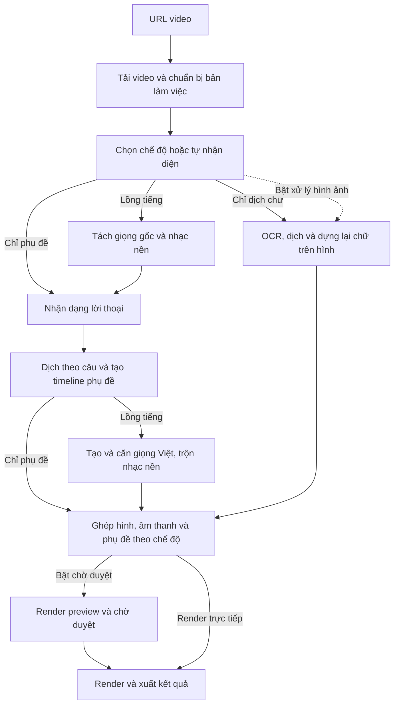

# Video Dubber

Video Dubber là ứng dụng web chạy trên máy cá nhân để Việt hóa video từ Douyin, TikTok, YouTube và Facebook. Từ một URL, ứng dụng tạo bản lồng tiếng Việt, bản phụ đề Việt hoặc bản dịch chữ xuất hiện trên hình. Giao diện hiển thị tiến độ từng bước và cho phép chỉnh lời dịch, duyệt bản xem trước và chạy lại từ bước đã chọn.

## Pipeline chính



### Các thành phần cốt lõi

| Thành phần | Vai trò trong pipeline |
| --- | --- |
| [Điều phối job](dubber/pipeline.py) · [FastAPI](dubber/app.py) · [Trạng thái job](dubber/jobs.py) | Nhận cấu hình từ giao diện, chọn các bước theo chế độ và cập nhật tiến độ. |
| [Tải video](dubber/downloader.py) · [Tự nhận diện](dubber/analyze.py) | Tải nguồn, chuẩn bị bản làm việc và dùng mẫu lời nói, chữ trên hình để gợi ý chế độ khi bật tự nhận diện. |
| [Tách âm thanh](dubber/separate.py) · [Nhận dạng lời thoại](dubber/asr.py) | Tách giọng và nhạc nền cho bản lồng tiếng. Faster-whisper tạo bản ghi lời thoại kèm mốc thời gian để dịch và căn phụ đề. |
| [Dịch lời thoại](dubber/translate.py) · [Provider dịch](dubber/providers/) | Gom các đoạn nhận dạng thành câu trọn ý, dịch sang tiếng Việt và giữ mốc thời gian. Có thể chuyển sang provider dự phòng theo cấu hình. |
| [Tạo giọng](dubber/tts.py) · [Nhận diện người nói](dubber/speakers.py) | Sinh giọng Việt theo câu, chọn giọng theo người nói khi bật tự động, và căn thời lượng đọc theo khoảng thoại. |
| [Dò phụ đề gốc](dubber/subdetect.py) · [Dịch chữ trên hình](dubber/screentext.py) | Tìm vùng phụ đề gốc để che khi cần. Nhánh OCR nhận dạng chữ theo thời gian và vị trí để dịch và vẽ lại tại vùng tương ứng. |
| [Kết xuất](dubber/render.py) | Dùng FFmpeg để dựng preview hoặc bản cuối, phối âm theo chế độ, áp dụng lớp chữ và xuất phụ đề SRT khi có lời thoại. |

### Chế độ đầu ra

- **Lồng tiếng + phụ đề Việt.** Giọng Việt thay lời thoại gốc, trộn với phần nhạc nền đã tách và đồng bộ với phụ đề.
- **Chỉ phụ đề Việt.** Giữ âm thanh gốc, bỏ qua tách nhạc và tạo giọng, có thể ghi phụ đề lên hình hoặc xuất SRT riêng.
- **Chỉ dịch chữ trên màn hình.** Giữ âm thanh gốc, bỏ qua nhận dạng lời thoại và tạo giọng, dùng OCR để dịch tiêu đề, nhãn và chú thích trên hình.

### Duyệt và chạy lại

Chế độ chờ duyệt dừng job sau khi render preview. Khi chạy lại, [checkpoint](dubber/checkpoint.py) dùng dấu vân tay của đầu vào, cấu hình và phiên bản bước để tái sử dụng các kết quả còn hợp lệ. Pipeline lưu bản dịch tự động trong `translate.json` và bản làm việc trong `lines.json` để giữ nội dung chỉnh tay khi dùng lại bản dịch.

## Chạy trên Windows

Với Python 3.11 và FFmpeg đã có trong PATH, chạy các lệnh sau từ thư mục repo.

```powershell
python -m pip install -r requirements.txt
python -m playwright install chromium
.\run.bat
```

Mở [Video Dubber](http://127.0.0.1:8765) trong trình duyệt. Xem [hướng dẫn chi tiết](README-legacy.md) để thiết lập GPU NVIDIA, cấu hình dịch và giọng đọc hoặc xử lý lỗi.
