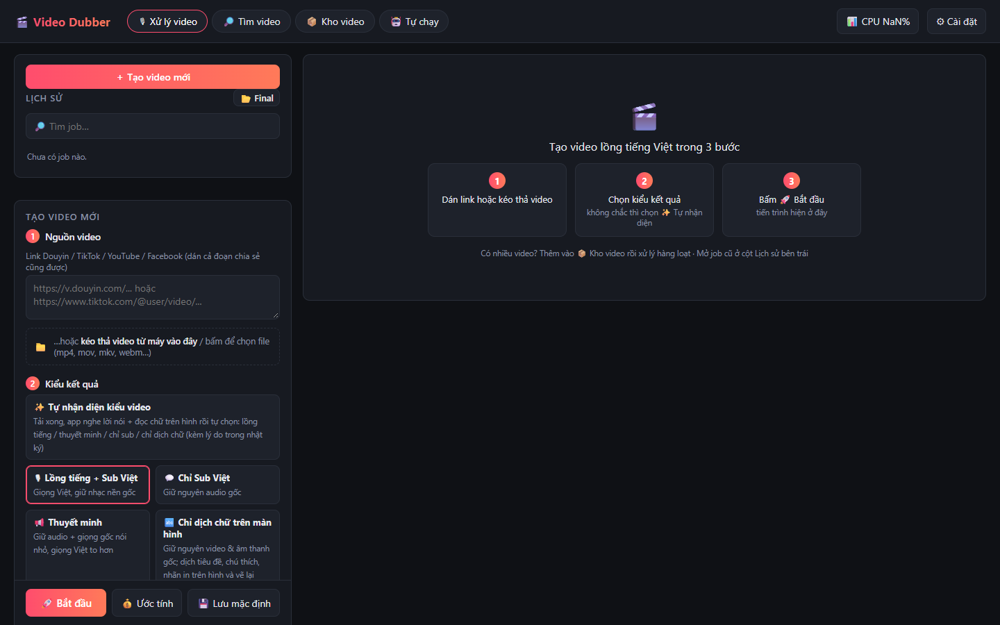
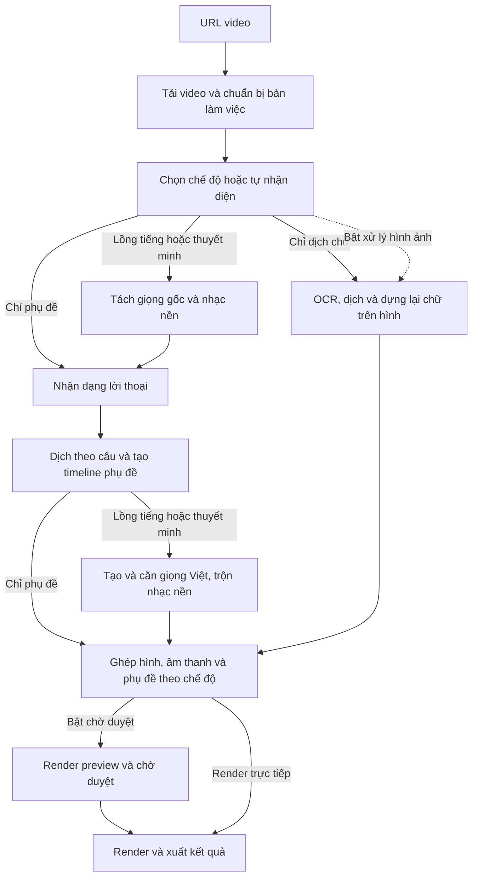
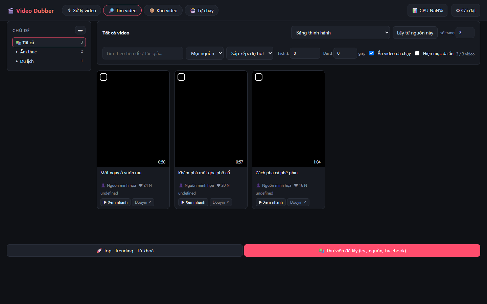
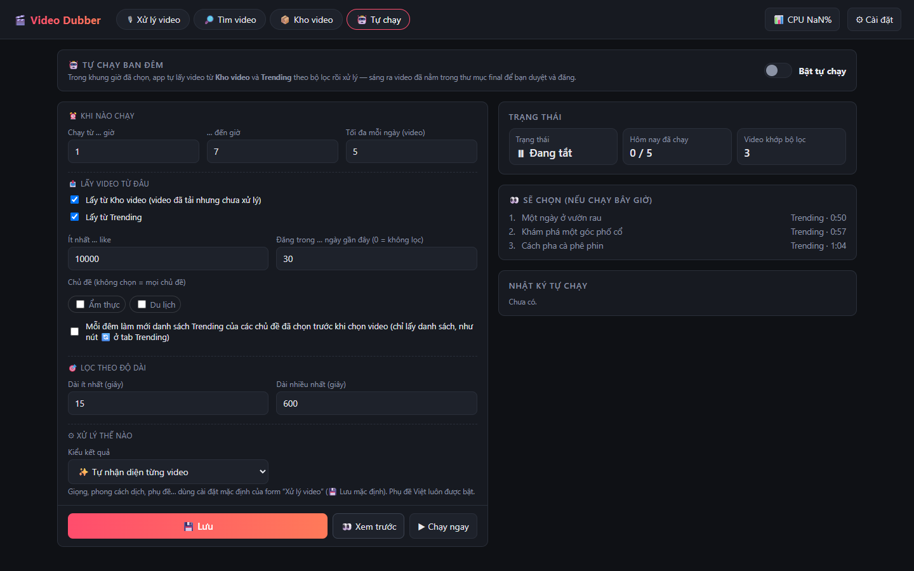
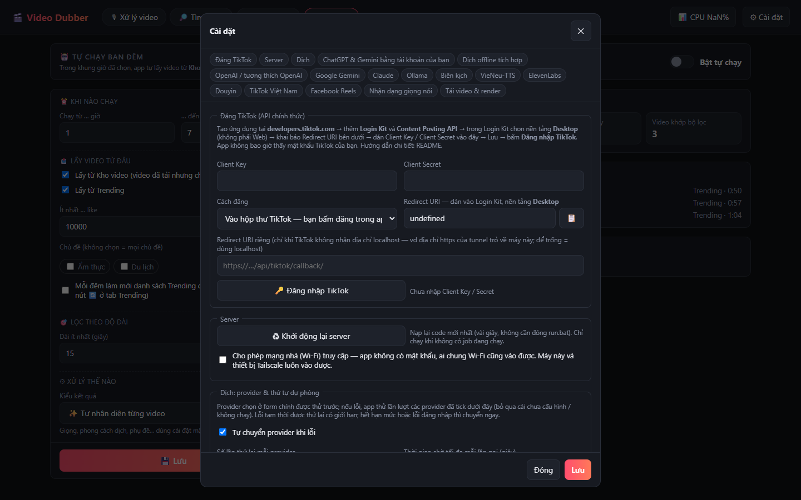

# Video Dubber

Video Dubber là ứng dụng web chạy trên máy cá nhân để Việt hóa video từ Douyin, TikTok, YouTube và Facebook. Từ một URL, ứng dụng tạo bản lồng tiếng Việt, bản phụ đề Việt hoặc bản dịch chữ xuất hiện trên hình. Giao diện hiển thị tiến độ từng bước và cho phép chỉnh lời dịch, duyệt bản xem trước và chạy lại từ bước đã chọn.

## Demo giao diện



[Xem video demo 20 giây](https://raw.githubusercontent.com/jbergloda1/video-dubber/main/docs/demo/video-dubber-demo.mp4) · [Tệp MP4 trong repo](docs/demo/video-dubber-demo.mp4)

Video đi qua bốn màn hình **Xử lý video → Trending → Tự chạy → Cài đặt**. Ảnh và video được chụp từ giao diện ứng dụng với dữ liệu minh họa.

## Pipeline chính



### Các thành phần cốt lõi

| Thành phần | Vai trò trong pipeline |
| --- | --- |
| [Điều phối job](dubber/pipeline.py) · [FastAPI](dubber/app.py) · [Trạng thái job](dubber/jobs.py) | Nhận cấu hình từ giao diện, chọn các bước theo chế độ và cập nhật tiến độ. |
| [Tải video](dubber/downloader.py) · [Tự nhận diện](dubber/analyze.py) | Tải nguồn, chuẩn bị bản làm việc và dùng mẫu lời nói, chữ trên hình để gợi ý chế độ khi bật tự nhận diện. |
| [Tách âm thanh](dubber/separate.py) · [Nhận dạng lời thoại](dubber/asr.py) | Tách giọng và nhạc nền cho bản lồng tiếng. Faster-whisper tạo bản ghi lời thoại kèm mốc thời gian để dịch và căn phụ đề. |
| [Dịch lời thoại](dubber/translate.py) · [Provider dịch](dubber/providers/) | Gom các đoạn nhận dạng thành câu trọn ý, dịch sang tiếng Việt và giữ mốc thời gian. Có thể chuyển sang provider dự phòng theo cấu hình. |
| [Tạo giọng](dubber/tts.py) · [Nhận diện người nói](dubber/speakers.py) | Sinh giọng Việt theo câu, chọn giọng theo người nói khi bật tự động, và căn thời lượng đọc theo khoảng thoại. |
| [Dò phụ đề gốc](dubber/subdetect.py) · [Dịch chữ trên hình](dubber/screentext.py) | Tìm vùng phụ đề gốc để che khi cần. Nhánh OCR nhận dạng chữ theo thời gian và vị trí để dịch và vẽ lại tại vùng tương ứng. |
| [Kết xuất](dubber/render.py) | Dùng FFmpeg để dựng preview hoặc bản cuối, phối âm theo chế độ, áp dụng lớp chữ và xuất phụ đề SRT khi có lời thoại. |

### Chế độ đầu ra

- **Lồng tiếng + phụ đề Việt.** Giọng Việt thay lời thoại gốc, trộn với phần nhạc nền đã tách và đồng bộ với phụ đề.
- **Thuyết minh.** Đặt giọng Việt lên trên tiếng gốc đã hạ âm lượng.
- **Chỉ phụ đề Việt.** Giữ âm thanh gốc, bỏ qua tách nhạc và tạo giọng, có thể ghi phụ đề lên hình hoặc xuất SRT riêng.
- **Chỉ dịch chữ trên màn hình.** Giữ âm thanh gốc, bỏ qua nhận dạng lời thoại và tạo giọng, dùng OCR để dịch tiêu đề, nhãn và chú thích trên hình.

### Duyệt và chạy lại

Chế độ chờ duyệt dừng job sau khi render preview. Khi chạy lại, [checkpoint](dubber/checkpoint.py) dùng dấu vân tay của đầu vào, cấu hình và phiên bản bước để tái sử dụng các kết quả còn hợp lệ. Pipeline lưu bản dịch tự động trong `translate.json` và bản làm việc trong `lines.json` để giữ nội dung chỉnh tay khi dùng lại bản dịch.

## Tìm nguồn và tải video



1. **Tìm video → Trending.** Chọn danh mục hoặc nguồn để lấy bảng thịnh hành, danh sách theo chủ đề hoặc kết quả tìm kiếm trên Douyin, hay Reels công khai từ một Facebook Page. Danh mục ánh xạ nguồn và từ khóa để phân loại kết quả.
2. **Lọc và chọn.** Lọc theo nguồn, từ khóa, lượt thích và thời lượng. Danh sách lưu metadata và ảnh bìa, gộp video trùng. Có thể dừng crawl hoặc lấy sâu hơn từ nguồn vừa lấy. Lỗi ở một nguồn được báo riêng.
3. **Tải hoặc xử lý.** Dùng **Kho video** để tải và giữ video nguồn cho lần xử lý sau. Từ Trending, có thể chọn video và đưa thẳng vào hàng đợi. Tab **Link hot** hỗ trợ tìm ứng viên từ TikTok Explore và Douyin trước khi chuyển link sang màn hình xử lý.

Mã nguồn phụ trách các luồng này nằm ở [Trending](dubber/trending.py), [Link hot](dubber/hot.py), [adapter nguồn](dubber/sources/) và [Kho video](dubber/library.py).

## Autopilot



[Autopilot](dubber/autopilot.py) mặc định tắt. Khi bật, ứng dụng kiểm tra định kỳ trong khung giờ theo giờ máy chủ, mặc định **01:00–07:00**. Nó ưu tiên video đã tải trong Kho và chưa có job, sau đó lấy ứng viên từ Trending theo chủ đề, lượt thích, độ mới và thời lượng. Video đã xử lý hoặc đã được chọn sẽ được bỏ qua.

- **Xem trước** hiển thị ứng viên theo bộ lọc và hạn mức hiện tại. **Chạy ngay** đưa ứng viên vào hàng đợi ngay theo hạn mức còn lại.
- Có thể bật làm mới Trending trước khi chọn video, đặt hạn mức mỗi ngày và chọn chế độ đầu ra hoặc để app tự nhận diện.
- Job tự động đi thẳng đến bản render cuối. Theo dõi lựa chọn và số lượng đã chạy trong tab **Tự chạy**. Video xuất ra nằm trong `final/`.

## Cài đặt và tùy chỉnh job



- **Dịch và giọng đọc.** Chọn provider dịch, thứ tự dự phòng, ngôn ngữ và phong cách dịch. Chọn giọng Việt, chế độ chọn giọng theo người nói và tốc độ đọc phù hợp với lời thoại.
- **Âm thanh và hình ảnh.** Chỉnh mức giọng Việt và nhạc nền, chế độ lồng tiếng hoặc thuyết minh, phụ đề SRT hoặc phụ đề gắn vào hình, vùng che phụ đề gốc, OCR và kích thước xuất.
- **Nguồn và kết nối.** Quản lý đăng nhập riêng cho nền tảng khi nguồn yêu cầu. TikTok Content Posting API có phần cấu hình đăng bài riêng. Cài đặt server điều khiển quyền truy cập từ mạng nội bộ.
- **Mặc định và từng job.** Lưu cấu hình dùng lại cho job mới hoặc đổi tùy chọn ngay trên job đang mở. Có thể bật chờ duyệt preview trước khi kết xuất.

## Chạy trên Windows

Với Python 3.11 và FFmpeg đã có trong PATH, chạy các lệnh sau từ thư mục repo.

```powershell
python -m pip install -r requirements.txt
python -m playwright install chromium
.\run.bat
```

Mở [Video Dubber](http://127.0.0.1:8765) trong trình duyệt. Xem [hướng dẫn chi tiết](README-legacy.md) để thiết lập GPU NVIDIA, cấu hình dịch và giọng đọc hoặc xử lý lỗi.
